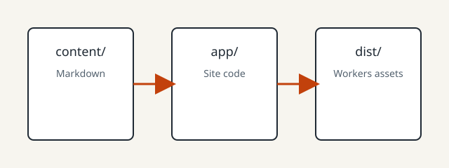

# Images and attachments

## Image

The same image is embedded twice: once with a WikiLink embed and once with a Markdown image link.

![[diagram.svg]]

## Attachment

Download the sample text file:

- [sample.txt](/assets/sample.txt)

`sample.txt` is stored in the site repository at `public/assets/`, so Vite copies it into the build without going through the content pipeline.

## Where the files live

The image lives in this Vault at `assets/`. The downloadable text file lives in the site repository at `public/assets/`.

Back to [[welcome]].
