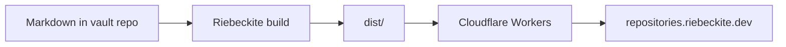

# Mermaid diagram

The `mermaid` plugin turns a fenced `mermaid` block into a diagram.

## Why this page exists

It checks that a plugin added on top of the starter preset works in the published site, not only in local development.

Return to [[welcome]].
